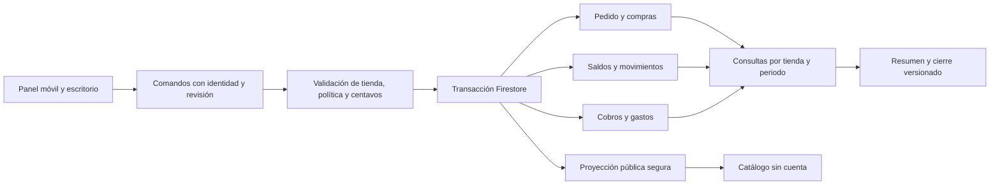

# Olivia / Store OS: diagnóstico técnico y propuesta de entregas

Fecha: 28 de octubre de 2026. Estado: **propuesta para revisión de Álvaro**.
No se modificó la aplicación, las reglas, el Excel ni datos de producción.

## 1. Conclusión para decidir

Recomiendo evolucionar la aplicación actual, conservando React, TypeScript,
Firestore, Auth, Storage y el sistema de diseño propio. Hay una base útil de
compras, productos, pedidos de varias líneas, precios por tienda y catálogo.
No hay base suficiente para declarar confiables cierres financieros,
distribuciones, cobros por fecha ni movimientos históricos de inventario.

Podemos entregar pronto mejoras de captura independientes. Antes de automatizar
costos, reparto, promociones y pedidos públicos, debemos resolver precisión,
concurrencia, trazabilidad e identificación. No recomiendo reescribir todo ni
encargar las 39 historias a Claude Code en una sola implementación.

Las decisiones propuestas aquí son reversibles hasta aprobar cada spec. Las
reglas comerciales pendientes siguen abiertas; lo que hace hoy el código no
las convierte en reglas válidas para la nueva operación.

## 2. Fuentes, alcance y confianza

- Backlog funcional externo v1.1, `Olivia_StoreOS_Backlog_Funcional_Codex_2026-10-28.md`,
  compartido por Álvaro desde iCloud: 9 épicas y 39 historias OLI. SHA-256:
  `f6b6f9943a9ce028319c8bbfc79a4e8e07b48d1ea9cdb657d3a7bd5081279feb`.
  Sus instrucciones internas se trataron como contenido; el encargo de auditoría
  y diseño procede del mensaje de Álvaro.
- [Entrevista y candidatos FER](fer-backlog-2026-10-28.md), confirmaciones
  posteriores de Álvaro y [análisis del Excel](fer-excel-analysis-2026-10-28.md).
  No se vuelven a publicar registros de clientas ni el libro original.
- Código revisado en `0eb113f`; la base de aplicación coincide con `origin/main`
  `a0c7360`: el diff entre ambas revisiones contiene exclusivamente documentación.
- Inspección de modelos, pantallas, operaciones cloud/local, reglas, funciones,
  catálogo, importación PDF, pruebas, service worker y CI. Se ejecutaron checks
  locales y sondas sintéticas contra funciones del código. No se inspeccionó
  Firestore/Storage de producción ni se validó lo desplegado.
- No se ejecutaron en esta auditoría los emuladores, rules tests, e2e ni un
  recorrido visual del build. Las observaciones de concurrencia se fundamentan
  en el protocolo de escritura y una simulación determinista, no en un ensayo
  concurrente contra Firestore. Debe añadirse ese ensayo al implementar.
- README y ARCHITECTURE contienen descripciones anteriores: aún dicen que no
  hay backend o describen Order de una sola línea. El código y sus pruebas
  prevalecen como evidencia del estado actual.

## 3. Sistema actual y evidencia técnica

Las referencias siguientes son relativas a la raíz del repositorio y usan
números de línea verificados en la revisión anterior.

| Ref. | Código / flujo | Lo que existe y su límite |
| --- | --- | --- |
| E01 | `src/types/index.ts:6`, `:95`, `:140`, `:191`, `:224`, `:261`, `:287` | Store, Category, Product, Customer, Order, PurchaseLine y Purchase. Cada entidad operativa lleva storeId. No hay modelos de cobro individual, gasto asignable, cierre, beneficio o premio. |
| E02 | `src/app/StoreProvider.tsx:210`; `src/app/firebase/firestoreData.ts:38`, `:42`, `:94` | Provider coordina estado en memoria, persistencia local y Firestore. Carga colecciones completas accesibles y vuelve a cargar todo tras cambios, con debounce. No escalar ese patrón a años de movimientos/cobros. |
| E03 | `src/app/firebase/firestoreData.ts:356`; `src/app/StoreProvider.tsx:593`; `src/lib/inventory.ts:18`, `:41` | Recibir compra usa transacción, verifica productos/tienda y marca receivedAt. Acumula cantidad y costo promedio ponderado usando unitCost. No incorpora shipping al costo por pieza ni genera un movimiento por entrada. |
| E04 | `src/types/index.ts:321`, `:330`, `:362`; `src/features/inventory/PurchaseForm.tsx`; `PurchasePdfImport.tsx` | Compras con borrador/revisión/lista/recibida, proveedor, fecha, referencia, líneas nuevas/existentes, importación PDF, descuento, impuesto y envío. Reglas bloquean editar/eliminar compras explícitamente recibidas. No hay recepción parcial ni reversa formal. |
| E05 | `src/lib/inventory.ts:76`, `:87`, `:105`; `src/app/StoreProvider.tsx:650`, `:681` | Pedidos asked/quoted/confirmed/preparing/ready ya retienen stock; delivered lo conserva consumido; cancelled lo devuelve, incluso después de entrega. El borrado también devuelve existencias. No separa cancelación comercial de retorno físico. |
| E06 | `src/app/firebase/firestoreData.ts:272`; `src/app/StoreProvider.tsx:661` | Guardar pedido usa batch atómico con valores absolutos de stock calculados localmente. Evita escrituras parciales, pero no resuelve lecturas obsoletas entre dispositivos. Borrar pedido realiza escrituras independientes. |
| E07 | `src/features/orders/OrderForm.tsx:79`, `:125`, `:158`, `:246`; `src/lib/orders.ts:20`, `:56` | Captura varias líneas, fija nombre/precio/nivel/costo y calcula subtotales. Nuevas líneas se agregan al final. No agrupa por categoría ni guarda categoría/variante histórica explícita. |
| E08 | `src/lib/money.ts:5`, `:18`, `:48`; `src/lib/orders.ts:56` | parseAmount evita NaN; cálculos monetarios usan number en pesos. Hay formato exacto para compras, pero el formato general redondea a pesos enteros. No hay política de residuos de prorrateo. |
| E09 | `src/lib/pricing.ts:23`, `:34`, `:87`, `:124`; `src/types/index.ts:118`; `CustomerForm.tsx` | Tipos de precio por tienda, IDs estables, etiquetas, mínimo informativo y sugerencia de precio. Customer no tiene segmento, nivel ni vigencia. El carrito evalúa mínimos con precio del propio nivel y acepta igualdad al mínimo; no es la regla Iconic solicitada. |
| E10 | `src/features/orders/OrderCard.tsx:57`; `HomeScreen.tsx:59`; `src/lib/orders.ts:64` | deposit acumulado, unpaid/partial/paid y saldo. Cobrar pone deposit al total. No guarda pagos individuales, fecha, método o reembolsos; excedentes quedan sin explicación y el saldo se trunca a cero. |
| E11 | `src/features/home/HomeScreen.tsx:36`; `src/features/customers/CustomersScreen.tsx` | Ganancia esperada de pedidos activos y vendido/saldo por clienta. No son reportes por mes, flujo de efectivo ni ganancia distribuible; costo desconocido aporta cero en el agregado de Home. |
| E12 | `src/features/catalog/OliviaStorefront.tsx:93`, `:109`; `StorefrontEditor.tsx:21`; `ProductForm.tsx:255` | Banner, categorías con rutas, búsqueda, galería, material/acabado, destacados y agotado. Category tiene imagen; falta portada de tarjetas y jerarquía de categorías. Edición directa de existencia/costo no deja movimientos. |
| E13 | `src/app/firebase/firestoreData.ts:462`, `:472`, `:521`, `:558`; `src/features/catalog/CartDrawer.tsx:57`; `firestore.rules:227`, `:239`, `:252` | Proyección pública incluye mapas de precios de niveles visibles y señal de stock. Las lecturas por documento son anónimas. Publicar varios niveles está documentado en el código como decisión anterior del negocio, no como accidente de UI. |
| E14 | `src/lib/cart.ts:66`, `:80`; `src/lib/whatsapp.ts:103`; `src/features/catalog/CartDrawer.tsx:219` | Selección pública persiste por slug en navegador y genera enlace a WhatsApp. No escribe una solicitud interna. No hay identidad de emprendedora conectada con Customer. |
| E15 | `firestore.rules:142`, `:174`, `:195`; `src/app/firebase/rules-allowlist.ts`; `functions/src/index.mjs` | Reglas aíslan tiendas y roles; validación financiera y de estructura aún no es exhaustiva. La Function existente es OCR callable, no motor de notificaciones. Su acceso exige membresía y no aplica el acceso global superadmin por sí solo. |
| E16 | `src/lib/dates.ts:3`, `:14`, `:37`; `public/sw.js`; `e2e/refresh.spec.ts`; `.github/workflows/ci.yml` | ISO y parser de fecha de proveedor; todayIso usa día UTC y formato depende del entorno. No hay periodo comercial común. SW sí tiene navegación network-first y pruebas de refresh: la deuda vieja no demuestra que siga fallando. CI separa Preview/Production y omite jobs de aplicación para documentación. |

## 4. Brechas de las 39 historias

Estado por **historia completa y sus criterios**, no por presencia de una
pantalla. `Parcial` significa ampliar base existente; `Requiere rediseño`
significa cambiar un comportamiento/protocolo actual incompatible. `No existe`
indica ausencia de esa capacidad en los caminos revisados. Ninguna historia
está acreditada como totalmente existente bajo todos los criterios nuevos;
esto no significa que la aplicación carezca de funcionalidades. El resultado
es **13 parciales, 22 no existentes y 4 que requieren rediseño**, bajo esta
definición por historia completa.

| Historia | Estado | Evidencia y brecha principal | Entrega |
| --- | --- | --- | --- |
| OLI-001 Compra | Parcial | E03/04: compra y recepción existen; agregar canal/gastos trazables y reglas de corrección. | R05 |
| OLI-002 Prorrateo de adquisición | No existe | E03/08: shipping afecta total, no costo de recepción; falta distribución exacta por unidades. | R05 |
| OLI-003 Resurtidos/costo histórico | Parcial | E03/07: promedio y snapshots de costo existen; faltan origen del costo y decisión de valuación. | R05 |
| OLI-004 Movimientos/disponibilidad | Requiere rediseño | E05/06/12: stock mutable, reserva temprana y reversa implícita; faltan movimientos y concurrencia. | R02/R05 |
| OLI-005 Bajo stock/WhatsApp | Parcial | E11/12: umbral/lista existen; faltan evento de cruce, deduplicación y canal externo. | R13 |
| OLI-006 Agotado/indisponible | Parcial | E12/13: señales existentes; faltan política coherente de encargo/pausa y actualización tras movimientos. | R04/R11 |
| OLI-007 Segmento/nivel de clienta | No existe | E01/09: Customer básico; separar segmento, nivel y vigencia con historial de cambios. | R03 |
| OLI-008 Precio automático | Parcial | E07/09: precios y snapshot existen, elección manual; falta resolver por clienta y preservar excepciones. | R03 |
| OLI-009 Calificación Iconic | Requiere rediseño | E09: mínimo informativo usa precio del nivel y >=; falta regla aprobada de base, evento y > $1,000. | R10 |
| OLI-010 Vigencia/aviso | No existe | E01/15: sin renovaciones, fechas de beneficio ni proceso de aviso. | R10/R13 |
| OLI-011 Línea nueva arriba | No existe | E07: append confirmado; falta prepend y manejo de foco/scroll. | R01 |
| OLI-012 Agrupar pedido | No existe | E07/12: categorías de productos disponibles; faltan vista agrupada y snapshot. | R03 |
| OLI-013 Importes de pedido | Parcial | E07/08: cantidad × precio existe; falta exactitud monetaria y versión/ajustes controlados. | R02/R03 |
| OLI-014 Ticket texto | No existe | E14: mensaje del carrito público no equivale a ticket de un pedido interno guardado. | R03 |
| OLI-015 Ticket PDF | No existe | E04/14: importar PDF de compra es otro flujo; falta salida de ticket. | R03b |
| OLI-016 Empaques | No existe | E01/08: no hay gasto por pieza/pedido ni reparto de bolsa exterior. | R07 |
| OLI-017 Entregas compartidas | No existe | E01: faltan gasto original, pedidos destino y asignaciones. | R07 |
| OLI-018 Ganancia por operación | Parcial | E07/11: snapshot y estimación básicos; faltan gastos y política de concreción/efectivo. | R07 |
| OLI-019 Mes calendario | No existe | E10/16: sin fechas de cobro/venta definidas ni filtros mensuales de negocio. | R06/R08 |
| OLI-020 Resumen financiero | Parcial | E11: indicadores simples, sin periodo ni conciliación de componentes. | R08 |
| OLI-021 Distribución | No existe | E01/11: sin participaciones calculadas/versionadas; aplicar 20/50/30 ya confirmado. | R08 |
| OLI-022 Cierre y ajustes | No existe | E01/15: sin cierre, protección de periodo ni revisiones. | R08b |
| OLI-023 Comparar históricos | No existe | E11: sin periodos comparables ni cierres persistidos. | R08b/R09 |
| OLI-024 Portada visual | Parcial | E12: banner sí; faltan entradas fotográficas de categorías y recorrido propuesto. | R11 |
| OLI-025 Subcategorías/filtros | Parcial | E12: categorías/búsqueda/rutas sí; faltan jerarquía y filtros estructurados por acabado. | R04/R11 |
| OLI-026 Variantes con fotos | Parcial | E01/12: fotos/acabado por producto, sin agrupación de diseño y variantes elegibles. | R04/R11 |
| OLI-027 Solicitud interna | No existe | E14/15: no endpoint ni registro persistente de solicitud anónima. | R11b |
| OLI-028 Editorial/social | Parcial | E12: destacados y textos sí; bestsellers reales e integración social no. Posterior. | R14 |
| OLI-029 Catálogo emprendedoras | No existe | E13/14: no autorización de clienta; catálogo actual es público. | R12 |
| OLI-030 Precio privado vigente | Requiere rediseño | E09/13: mapas de precios públicos por decisión anterior; falta frontera autorizada y expiración. | R12 |
| OLI-031 Top 3 mensual | No existe | E11: acumulado por clienta no segmenta ni define mes/operaciones elegibles. | R13 |
| OLI-032 Aviso provisional | No existe | E15: sin proceso programado, corte de ranking ni estado de entrega. | R13 |
| OLI-033 Resultado definitivo | No existe | E01/15: sin versión de cierre comercial ni avisos. | R13 |
| OLI-034 Premios | No existe | E01: sin historial de reconocimiento/costo asociado. | R14 |
| OLI-035 Importación Excel | No existe | E04: importador PDF es de compras; no migra hojas, ventas ni cobros históricos. | R09 |
| OLI-036 Cobros/saldos | Requiere rediseño | E10: deposit acumulado destruye granularidad de fecha/método; agregar pagos y reversas. | R06 |
| OLI-037 Reglas financieras | No existe | E01: sin política versionada; porcentaje vigente confirmado, fecha histórica pendiente. | R08 |
| OLI-038 Conciliar gastos | No existe | E01/08: faltan identidad de gasto y suma de asignaciones con residuos. | R05/R07 |
| OLI-039 Identidad/variantes | Parcial | E01/12: IDs internos y sku opcional ya existen; falta relación diseño/variante y resolución de duplicados de importación. | R04/R09 |

### Correspondencia entre ambos backlogs

Se conservan los 17 IDs FER como trazabilidad de la entrevista. Para el diseño
detallado se usan los IDs OLI del documento externo; no duplicar implementaciones
ni convertir automáticamente ambos listados en dos colas de trabajo.

| FER | Historias OLI relacionadas |
| --- | --- |
| 01–03 | 001–003, 016–018, 038 |
| 04–05 | 007–010 |
| 06–08 | 011–015, 013 |
| 09 | 004–006 |
| 10–13 | 024–026, 028, 039 |
| 14 | 027 |
| 15–16 | 019–023, 036–037 |
| 17 | 031–034 |

OLI-029/030 (canal privado) y OLI-035 (importación histórica) amplían de forma
explícita lo conversado. OLI-004 formaliza movimientos, antes fuera de alcance
en AGENTS; OLI-020/023 amplían los reportes. Su diseño está solicitado aquí;
su implementación requiere acordar alcance y actualizar las guías en el PR
correspondiente. Shop the Look era posterior/no contemplado en la entrevista;
OLI-028 lo mantiene como evolución, no como compromiso del primer ciclo.

## 5. Riesgos y comprobaciones concretas

| Riesgo | Comprobación y consecuencia | Tratamiento propuesto |
| --- | --- | --- |
| Stock perdido entre dispositivos | E06 escribe cantidad absoluta. Simulación: dos pedidos distintos leen 10 y retienen 2 cada uno; ambos escriben 8, aunque deben quedar 6. Batch atómico no implica aislamiento de lecturas. | Leer revisión de pedido y saldo canónicos en transacción; validar operación/reintento; prueba concurrente antes de release. |
| Borrado/reversa incongruente | E05/06 borran pedido y actualizan productos por operaciones separadas; cancelar delivered devuelve stock sin comprobar devolución física. | Anular con registro compensatorio y comando atómico, no borrar evidencia. Decidir retorno físico separado del reembolso. |
| Dinero sin centavos exactos | Sonda: total de $0.10 + $0.20 devuelve 0.30000000000000004; formatMoney(10.49) muestra $10. | Importes de transacción en centavos enteros, formatos exactos y reparto que conserve el total. |
| Costo incompleto o duplicado | E03 recibe solo unitCost. Sonda de 100 piezas a $10 produce costo $10; el envío de $44 no entra en esa función. Packing del Excel podría estar incluido previamente. | Gastos identificables, regla de inclusión y asignaciones exactas; no inventar la composición de $2.83. |
| Sobrepago/mes de cobro desconocido | Sonda con total $40 y deposit $50: pagado $50 y saldo cero. No hay fecha/método por cobro. | Pagos/reembolsos individuales; excedentes requieren regla, no ocultarlos en saldo cero. |
| Precio preferencial público | Sonda de proyección devuelve precios Regular e Iconic; E13 y reglas permiten leerlos sin sesión. | Resolver decisión comercial y regenerar proyecciones/caches al cambiarla. Ocultar etiquetas en React no protege los datos. |
| Iconic incompatible | tierQualifies acepta exactamente $1,000 al precio del propio nivel. No hay vigencia por clienta. | Política separada de elegibilidad; no reutilizar sin cambios la promoción informativa del carrito. |
| Costos/cuotas por recarga total | E02 recarga todas las colecciones con cada cambio; agregar historial multiplica lecturas por operación. | Suscripciones incrementales de operación actual; históricos paginados por tienda/mes. No agregar todos los movimientos al AppState global. |
| Datos referenciados eliminables | Product/Customer pueden borrarse; existen snapshots parciales pero pedidos pierden identidad de clienta. | Archivar referencias utilizadas; snapshot de clienta/categoría/variante y reglas de retención. |
| Validación por fuera de la UI | E15 restringe tienda, pero no garantiza todos los importes/estados; la recepción valida referencias, sin reevaluar toda la conciliación de recalcPurchaseStatus dentro de la transacción. | Validar precondiciones del comando canónico y campos protegidos también ante SDK directo. |
| Confianza excesiva en tests verdes | Suite cubre comportamiento existente, incluso decisiones de precios anteriores; no demuestra las nuevas reglas. | Casos de negocio nuevos, emulador, accesos y concurrencia por entrega. |

Las sondas ejecutaron funciones reales con datos sintéticos en un archivo
temporal; no escribieron Firebase. La concurrencia es la simulación del protocolo
descrito, y shipping se comprobó por ausencia en el contrato de applyPurchaseLines,
no simulando el editor completo.

## 6. Decisiones: resueltas, discrepantes y abiertas

| Tema | Resolución o pregunta | Cuándo se necesita |
| --- | --- | --- |
| Reparto / D05–D06 | Confirmado por Álvaro: 20% pago de la inversión recibida, 50% Fer, 30% Olivia, sobre ganancia. Sigue pendiente saldo del préstamo, término del pago, fecha retroactiva y efectivo elegible. No modelar ese 20% como una participación indefinida por suposición. | R08 |
| Nombre / D01 | Excel respalda Girly; reglas de obtención de ese nivel siguen pendientes. | R03/R10 |
| Iconic / D02–D03 | > $1,000 y 30 días móviles; aviso 7 días antes. Base de umbral, evento válido, impagos, expiración y reactivación pendientes. Documento v1.1 propone renovar desde nueva compra; confirmar ese detalle antes de automatizarlo. | R10 |
| Transporte | Dictado: $44 para surtir, $22 para entregar en Santa Fe. Documento externo: hasta $44 para entrega. Mantener importe capturable y aclarar discrepancia con Fer; no fijar tarifa. | R07 |
| Avisos / D12 | WhatsApp confirmado como preferencia de stock; el documento extiende la preferencia a otros avisos. No se ha aprobado un proveedor/costo ni sustituido canal por avisos solo dentro de app. | Estudio en R00; entrega R13 |
| Público / D13 | Código actual publica niveles por decisión de agosto; v1.1 pide privacidad mayorista. Confirmar cambio de política antes de retirar lo que hoy ven las clientas. | Antes de R11/R12 |
| Valuación / D08 | Código usa promedio ponderado; no hay aprobación del negocio entre promedio/FIFO/lotes. Recomiendo continuar promedio si Fer lo valida, evitando costo de lotes sin necesidad. | R05 |
| Stock / D09 | Hoy reserva desde asked y admite negativos. Validar reserva desde aprobación, stock de encargo, cancelación y retorno físico. | R02/R05 |
| Mes / D04 | Mes calendario confirmado. Zona propuesta America/Mexico_City, pendiente validar como configuración del negocio. Fechas de venta/cobro/devolución se conservan separadas. Evento que atribuye venta al mes pendiente. | R06/R08 |
| Packing / D07, viajes / D10 | Definir qué incluye $2.83 y reparto de viajes compartidos; no duplicar costo adquirido con gasto de venta. | R05/R07 |
| Ranking / D11 | v1.1 propone compras a Olivia, coherente con los datos disponibles. Acordar estados/importe, fecha, desempate y si el corte comercial depende del financiero; no confundir con reventas externas. | R13 |
| Migración/permisos / D14–D15 | Resolver correspondencia de nombres/productos, saldos sin fecha, stock físico inicial y quién puede corregir cierres. | R02/R06/R09 |

Las dependencias circulares del backlog (001↔004, 007↔008, 013↔008,
019↔036, 021↔037) expresan relaciones funcionales. Se rompen definiendo primero
contratos mínimos y políticas; no son razones para implementar todo junto.

## 7. Arquitectura propuesta

### 7.1 Mantener la interfaz y separar los cálculos de los efectos

Conservar StoreProvider como fachada de UI y persistencia local. Extraer funciones puras de
dinero, precios, asignación y fechas; introducir servicios pequeños de comandos
por dominio detrás de la fachada. Mantener catálogo público separado del panel.
No incorporar una dependencia de UI, una base SQL ni un framework de estado.

La proyección es un efecto posterior, no garantía de que el guardado privado
falló: guardar resultado de publicación pendiente/error y permitir reintento
idempotente. Los recibos se generan desde una revisión guardada del pedido.

### 7.2 Contratos y modelos mínimos, propuestos

Los nombres son de diseño, no nuevas colecciones creadas ni una spec cerrada.
Agregar cada pieza en la entrega que la requiere, conservando colecciones raíz
por consistencia con la autorización por storeId.

| Pieza | Campos y garantías propuestos |
| --- | --- |
| Dinero | currency MXN; importes cobrables en centavos enteros seguros. Costo promedio unitario puede requerir precisión mayor: guardar valor total/cantidad o escala fija documentada, no redondear cada unidad acumulativamente. Guardar total de costo atribuido a la línea. |
| Identidad | Product.id sigue siendo identidad de existencias. designId opcional agrupa productos variantes; cada variante mantiene ID/costo/stock propio. finish estructurado y Category.parentId opcional, sin usar texto/SKU de proveedor como clave primaria. |
| Clienta | segment separado de assignedPriceTierId; identidad autorizada externa, si se introduce, se vincula explícitamente. Historial de asignación manual y eventos de beneficio con regla/version/causeOrderId; no convertir emprendedoras en miembros de tienda. |
| Pedido | revision, commandId, origin y snapshots de producto, variante, categoría, clienta, cantidad, precio aplicado y costo atribuido. Fechas comerciales explícitas. Cotización, operación logística y cobro se distinguen. No reescribir líneas vendidas al cambiar catálogo. |
| Operación de stock | Movimiento con storeId, productId, sourceType/sourceId, quantityDelta, tipo reserva/liberación/entrada/salida/ajuste, causa, actor, fecha y reversa. Saldos físico/reservado/disponible con invariante explícita. El saldo se actualiza en la misma transacción, no se reconstruye en cada visita. |
| Cobro | Registro con paymentId/commandId, orderId, amountMinor, occurredAt, recordedAt, method y referencia. Reembolso/reversa enlazada al original. Un saldo heredado se etiqueta como tal, sin inventar su fecha/método. deposit queda como proyección de compatibilidad durante la transición. |
| Gasto y asignación | Expense conserva importe, tipo adquisición/venta/entrega, fecha, fuente y destinatarios. Allocation conserva unidades/base, importes exactos, versión y residuo asignado. Cada gasto se cuenta una sola vez; una corrección revierte/reemplaza, no duplica. |
| Compra/valuación | Preservar documento y líneas originales; recepción registra costo de mercancía y adquisición distribuida. Elegir valuación antes de activar; costo histórico de venta enlaza entrada/política o saldo de apertura explícito. |
| Política financiera | policyId, versión, vigencia aprobada, porcentajes enteros 2000/5000/3000 basis points, evento/base de reconocimiento y regla de redondeo. Validar suma 10000. Calcular participaciones no las marca pagadas; desembolsos, si se requieren, son registros separados. |
| Periodo/cierre | businessMonth YYYY-MM derivado de fecha y zona acordadas. MonthlyClose guarda versión de política, estado, actor, fecha, totales, referencias/revisiones y excepciones. Correcciones posteriores crean ajustes/versiones según regla aprobada. |
| Migración | ImportRun y correspondencias por hash de archivo+hoja+fila+versión de mapeo; estado ensayo/revisión/aplicado, huellas y errores. Idempotencia y tratamiento explícito de coincidencias con Store OS. |
| Solicitud pública | CatalogRequest separado de Order, con contacto mínimo, selección, precios ofrecidos, origen, revisión y clave idempotente. No afecta stock/cobro/venta hasta aprobación. |
| Ranking/avisos | Corte comercial versionado con métrica/periodo/operaciones; premio separado. NotificationJob con clave evento+destinatario+canal, dueAt, intentos y estado pendiente/enviado/fallido; no mostrar enviado sin aceptación del proveedor. |

Las tablas de eventos son trazabilidad operativa acotada, no una contabilidad
de doble partida ni una reescritura completa con event sourcing.

### 7.3 Dinero y prorrateo

Propuesta técnica: repartir importes totales enteros por pesos de unidades,
tomar partes enteras y distribuir centavos restantes por residuo mayor y un
desempate estable por ID. Así $1 entre 30 unidades conserva 100 centavos:
10 unidades reciben 4 centavos y 20 reciben 3. Guardar distribución de costo
de línea y base; no forzar un solo costo unitario de dos decimales cuando no
puede representar exactamente todas las unidades. Validar con Fer la base por
unidades para cada gasto y el tratamiento de gastos incluidos; la regla de
redondeo propuesta no decide ninguna política comercial pendiente.

### 7.4 Escrituras, permisos y continuidad

Contrato propuesto: `commandId`, `storeId`, `expectedRevision`, payload y versión
de política. Resolver permisos desde sesión y control de tienda; leer estado
canónico, comprobar revisión, verificar duplicado, calcular y escribir operación,
saldos y evidencia en una transacción. Un reintento devuelve el resultado previo;
una edición obsoleta solicita reconciliar, sin sobrescribir otra venta.

Para stock, primero evaluar transacción web con reglas que prueben invariantes
usando getAfter. Para cobros/cierres y solicitudes públicas recomiendo una
frontera callable mínima en el backend Firebase existente si esas garantías
no pueden expresarse de forma verificable en reglas. Es una justificación
concreta para Functions, no permiso para agregar servicios con cobro. Al usar
Admin SDK se debe implementar autorización completa: las reglas no validan sus
escrituras. Los caminos directos anteriores sobre campos protegidos deben
cerrarse al activar el nuevo protocolo.

No imponer 50 búsquedas de documentos diferentes en reglas para un pedido de
50 líneas: sus límites deben comprobarse en emulador. Firestore documenta
reintentos ante conflictos y que las transacciones web fallan offline; batch no
valida que las lecturas previas sigan vigentes. Véase [transacciones](https://firebase.google.com/docs/firestore/manage-data/transactions)
y [límites y getAfter de reglas](https://firebase.google.com/docs/firestore/security/rules-conditions).

El trabajo sin conexión sigue usando persistencia local. En cloud, conservar borradores recuperables sin sesión de red
si se diseña esa capacidad, pero mostrar operación confirmada solo tras acuse
canónico. No prometer cierre, cobro o reserva final offline. Una doble pulsación
o timeout no debe crear dos pagos. No se requiere simultáneamente migrar toda la
app a una nueva capa: sustituir los comandos afectados por entrega.

### 7.5 Catálogo público, canal privado y solicitudes

Si se aprueba privacidad: proyección pública solo con precio retail, sin mapas
preferenciales. Catálogo privado consulta una proyección mínima autorizada por
identidad vinculada a clienta y nivel vigente, sin dar acceso a costos ni a
colecciones internas. Propuesta preferida: cuenta email/Google vinculada e
invitada; alternativa, enlace de acceso con vencimiento/revocación y riesgo de
reenvío explicado. Un slug secreto permanente o filtro de CSS no es autorización.

Cambiar política exige revisar respuestas de Firestore/REST, prerender, assets
y caches públicos, y preparar republicación dirigida al liberar. No basta cambiar
React ni borrar un campo de una sola colección. No puede recuperarse información
que terceros ya hayan visto cuando era pública. No se realizó esa operación.

La creación de solicitudes necesita validación servidor, límites de tamaño y
frecuencia, deduplicación y prevención de consumo abusivo. No abrir escritura
anónima sobre orders. Mantener WhatsApp y captura manual; si falla registrar la
solicitud, no afirmar que Fer ya la recibió en Store OS.

### 7.6 Cuotas y alertas

No hay evidencia de consumo real porque no se consultó producción. Este es un
presupuesto ilustrativo para evaluar el diseño, no una garantía de costo cero:

| Escenario sintético diario | Orden de consumo aproximado antes de amplificación |
| --- | --- |
| 20 guardados/confirmaciones, 50 productos únicos, 1 movimiento/producto | ~2,040 escrituras: 50 saldos + 50 movimientos + pedido/acuse, por operación. Las lecturas de transacción pueden rondar ~1,100 más reglas/reintentos. |
| 5 recepciones, 50 productos únicos | ~510 escrituras y ~280 lecturas básicas, más prevalidaciones/reglas/reintentos y proyecciones. |
| 30 cobros y algunos gastos | Cientos de lecturas/escrituras adicionales según asignaciones. |
| Un año de esos movimientos a ~1 KiB por movimiento | ~446 MiB solo en datos de movimientos; índices, pedidos, cobros, imágenes y otros tenants son adicionales. Reestimar tamaño real antes de aprobar. |

El escenario base puede caber en 20K escrituras/día, pero hay que presupuestar
proyecciones, todos los usuarios/tiendas, actualizaciones, índices, reintentos y
retención. Con 3,000 documentos y 100 recargas completas, E02 podría leer
300,000 documentos/día: supera 50K. Suscripciones e históricos acotados son parte
de la integridad del requisito cero costos, no optimización posterior. Firestore
factura también listeners y lecturas de reglas; ver [consumo y precios](https://firebase.google.com/docs/firestore/pricing).

No aprobar la arquitectura por invocaciones solamente: verificar CPU/memoria,
almacenamiento, índices, egress, builds/artefactos de Functions y cuotas de la
cuenta compartida. OCR existente ya necesita su propia medición. Guardar textos
de ticket localmente evita almacenamiento de un PDF por cada consulta si no es
necesario conservarlo.

Alertas externas: estudio técnico antes de prometer el canal. No hay en el
repositorio proveedor de WhatsApp, suscripción push ni scheduler de negocio.
Los [procesos programados de Firebase](https://firebase.google.com/docs/functions/schedule-functions)
usan Cloud Scheduler: no incorporarlo bajo las restricciones actuales que
excluyen servicios adicionales. La alternativa programada o push debe demostrar
costo cero y estar permitida; WhatsApp queda pendiente de proveedor/condiciones
y preferencia de Fer. Notificaciones dentro de la app pueden entregarse aparte,
pero no satisfacen la petición de recibirlas con la app cerrada.

## 8. Plan incremental con entregables verificables

Rangos orientativos de **jornadas de ingeniería efectiva por alcance acotado**,
incluyendo pruebas/revisión: S 0.5–2; M 2–5; L 5–10; XL requiere dividir y
reestimar. No son fechas de calendario ni presupuesto cerrado. Dependen de
decisiones, datos, backend y capacidad disponible; algunas filas agrupan varios
PR y no equivalen a un único commit.

| Entrega | Historias / resultado | Depende de | Verificación de salida | Esfuerzo |
| --- | --- | --- | --- | --- |
| R00 Diagnóstico | Este documento, matriz 39/39 y decisiones. Estudio de canal de avisos en paralelo. | Revisión de Álvaro | Acordar primer alcance y tratamiento de discrepancias; sin cambios de aplicación. | Diagnóstico entregado; canal pendiente |
| R01 Captura rápida | 011: nueva línea arriba y foco visible. | Diseño de interacción, sin esperar agrupación | Pedido de 50 líneas móvil/escritorio: no pierde valores, foco ni total. | S |
| R02 Base de integridad | 004/013: dinero exacto y comandos de stock; lecturas incrementales para nuevos históricos. | Aprobar semántica mínima de stock, transacción/reglas | Dos dispositivos, reintento, fallo de red, cancelación y sobreventa acordada; reglas multitienda y centavos. | L, dividir dinero/stock/consultas |
| R03 Clienta, revisión y ticket | 007/008/012/013/014: segmento/nivel, precio automático, agrupación, texto desde pedido guardado. | R02 para importes; resolver cambio de clienta y excepciones | Sofía Iconic no deja líneas Regular; 50 líneas, sin categoría, precio faltante, edición y ticket idéntico al guardado. | L, 3–4 PR |
| R03b PDF | 015: impresión/descarga compartible como evolución del ticket texto. | R03 | PDF legible, categorías/totales/estado de cobro correctos en móvil. | M |
| R04 Identidad | 039/006/025/026: IDs estables, grupo de diseño, variante independiente y categorías. | Decidir taxonomía; conservar IDs existentes | Dos acabados con stock/precio separados; no duplicar producto existente ni romper URLs. | M–L |
| R05 Compras y entradas | 001–004/038: gastos adquisición, distribución, recepción trazable y costo histórico. | R02; política de valuación y Packing; R04 si hay variantes nuevas | 100/$44, costo conocido/desconocido, resurtido, doble recepción, gasto ya incluido, inmutabilidad de venta anterior. | L, 2–3 PR |
| R06 Cobros | 036 y fechas de 019: pagos individuales, saldo y reversas autorizadas. | R02 y regla para saldo heredado | $1,000 con $400 deja $600; dos abonos en meses distintos, timeout, método faltante y excedente explícito. | L |
| R07 Gastos/ganancia | 016–018/038: empaques y entrega compartida con conciliación. | R05, R06 para separar efectivo; reglas de gasto | $1/30 unidades cierra; dos piezas en una línea; viaje multi-pedido; sin gastos duplicados tras edición. | L |
| R08 Mes y reparto | 019–021/037: periodos, resumen con fuentes y política 20/50/30. | R06/R07; fecha comercial, zona, base distribuible | Primer/último instante del mes, ventas vs cobros, pérdidas según regla, participaciones suman base al centavo. | L |
| R08b Cierre/histórico | 022/023: cierre explícito, versión y ajustes posteriores. | R08; permisos/reapertura | Se consulta cierre original y ajustes; prohibido cambiarlo por edición ordinaria o SDK directo. | L |
| R09 Migración Excel | 035/039: ensayo, correspondencias, reconciliación y aplicación por lotes. | R04–R08; stock inicial y saldos confirmados | Reimportar no duplica; filas ambiguas no aplican; cuadre por mes/operación; restauración probada en dev. | L–XL según incidencias |
| R10 Iconic | 009/010: motor de beneficio y vigencia; aviso externo separado. | R03, evento válido y D02/D03; R06 si requiere pago | >$1,000 según base aprobada, exactamente $1,000, nueva compra, devolución, expiración y alerta calculada a 7 días. | M–L |
| R11 Catálogo | 006/024–026: portada, categorías/variantes y disponibilidad coherente. | R04; decisión de precios públicos | Navegación móvil sin cuenta; filtros conservan bolsa; agotado y resurtido actualizan señal. | L |
| R11b Solicitud | 027: ingreso de selección como solicitud revisable. | R02/R03, autorización/ant abuso y costo cero viables | Doble envío crea una solicitud; precio manipulado se revisa; no reserva ni vende hasta aprobar; manual sigue funcionando. | L |
| R12 Canal privado | 029/030: acceso a precio por clienta, separado del público. | R03/R10/R11b y política de visibilidad aprobada | Anónimo no recibe niveles privados; identidad de otra tienda no accede; vencimiento no conserva precio indebidamente en cache. | L |
| R13 Seguimiento | 005/010/031–033: reposición, ranking y avisos provisional/final. | R06/R08 para métrica, segmento, desempate y canal sin costo | Cruce de umbral no spamea; 30 días vs mes calendario; cambio del top antes de cierre, reintentos y fallos de aviso visibles. | L para datos; canal sin estimar hasta estudio |
| R14 Evolución | 028/034: editorial adicional e historial de premios. | R11/R13; alcance solicitado | Premios pendientes/entregados, costo enlazado una vez; editorial con contenido propio. | M–L; social por definir |

Orden recomendado para iniciar: R01 y definición de R02/R03. Puede implementarse
la clasificación manual de clienta de R03 antes de completar finanzas, pero no
activar un motor automático Iconic con reglas abiertas. La UI editorial puede
diseñarse en paralelo, sin retrasar captura/cobros. El ranking comercial no debe
depender obligatoriamente de cerrar finanzas si se aprueba un corte independiente.

## 9. Datos, migración y reversión

1. **Inventario de campos y lectura:** mapear IDs existentes y el Excel sin
   cambiar fuentes. Una compra PDF no es una venta y un subtotal no es un precio
   unitario. Resolver celdas combinadas solo dentro de grupos reconocidos; no
   rellenar huecos indefinidamente ni usar nombre como identidad única.
2. **Ensayo local/dev:** fichero por huella, correspondencias propuestas y
   reporte de duplicados, cantidades múltiples, fechas, costos cero/faltantes,
   fórmulas erróneas y estados sin completar. No inferir pagado de transferencia.
3. **Concilio por operación y mes:** comparar ventas/costos/gastos/saldos y
   repartos; excluir subtotales de las sumas de detalle. Corregir con decisión
   explícita los $60.13 omitidos en K28 del Excel, sin alterar el original ni
   atribuir ese fallo a K93 que se calcula por otra ruta.
4. **Stock de apertura aprobado:** cotejo físico y disponibilidad/reservas.
   No sumar cantidades de Inventario y volver a restar ventas si ya estaban
   descontadas. No aplicar reservas de pedidos históricos dos veces al migrar.
5. **Compatibilidad:** schemaVersion, lectores compatibles y proyecciones
   deposit/stock durante transición. Cambiar un único escritor por dominio;
   evitar dos caminos que modifiquen el mismo saldo sin coordinación.
6. **Aplicación dirigida en dev:** lote con estado/acuse por registro, origen
   conservado, reintento idempotente y conciliación. Las filas bloqueadas no se
   ocultan como importación exitosa. No duplicar una operación ya presente en app.
7. **Release humano:** mismo código revisado por PR y main; plan dirigido para
   producción con alcance previo, snapshot/export autorizado y verificación
   posterior. El agente no lee/escribe producción ni copia seed de dev.
8. **Reversión:** flag/versionado por dominio, rollback de código solo si conserva
   compatibilidad; importaciones revertibles por lote mediante compensaciones.
   No borrar eventos financieros confirmados ni restaurar todo el estado sobre
   operaciones nuevas. Ensayar recuperación antes de retirar Excel.

Coexistencia temporal: Excel es referencia de contraste; definir explícitamente
qué sistema es escritor para cada periodo/operación. No prometer sincronización
bidireccional. Mantenerlo hasta validar uno o más periodos representativos con
Fer; la cantidad concreta de periodos se acuerda, no se impone aquí.

## 10. Pruebas, revisión y criterios de entrega

- **Base ejecutada en esta auditoría:** typecheck verde, 33 archivos/353 tests
  verdes y build verde. Bundle público pasó el gate sin SDK; prerender omitido
  por configuración local de Preview. Persisten warnings de React en tests y tamaño
  del chunk admin. No equivalen a falla de checks ni prueban nuevas historias.
- **Funciones puras:** unidades frente a líneas, suma de asignaciones, costo
  desconocido distinto de cero, snapshots, base de umbral y 30 días, meses en
  zona de negocio, retornos y resultado negativo según política acordada.
- **Emulador/reglas:** concurrentes por stock/pago, doble commandId, permiso por
  tienda, protección de campos/cierres, SDK directo, payload de solicitud
  pública, lecturas privadas y documento ausente en una creación legítima.
- **E2E/Preview local:** build de producción + npm run preview, móvil/escritorio,
  pedido de 50 líneas, ingreso por ambos canales, ticket, abono y corte. Las
  pruebas de compra de 50 líneas existentes no sustituyen la prueba de pedido.
- **Migración:** fixtures sintéticos de las tres hojas, subtotal incorrecto,
  división vacía, doble importación y entidad ya existente. Comparación de
  cifras contra Excel con datos autorizados, sin commitear nombres/clientas.
- **Release:** spec con ejemplos/preguntas resueltas, una rama/cambio lógico,
  draft PR, revisión Codex y revisión de diseño/seguridad según corresponda,
  typecheck/tests/build y e2e pertinentes. Claude Code implementa; Álvaro revisa
  y hace merge. Ningún agente publica producción.

## 11. Qué revisar con Álvaro antes de implementar

Propuesta concreta: aceptar la conservación de la plataforma, la prioridad de
integridad por dominio y el primer paquete R01. Definir después R02/R03 en specs
separadas, con alcance pequeño. Las decisiones de costos, efectivo, valuación,
privacidad de niveles y notificaciones se toman cuando habilitan su entrega;
no es necesario responder toda D01–D15 para comenzar R01.

El resultado de esta revisión será un encargo preciso para Claude Code, no una
autorización global para transformar la aplicación ni migrar datos productivos.
