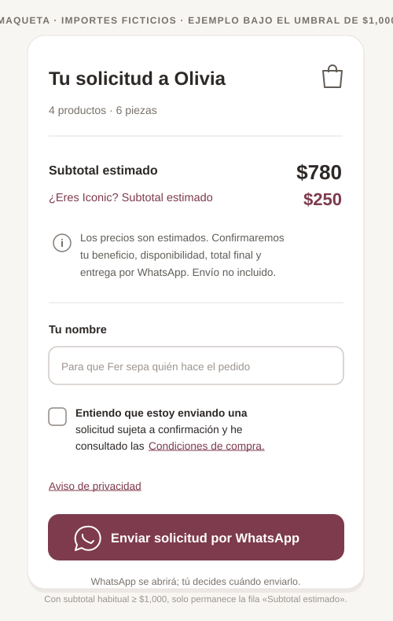

# Olivia — carrito público de solicitud: resumen de un vistazo

**Estado:** diseño de UX aprobado por el PO tras revisión con Fer (10-nov-2026). Implementación pendiente.  
**Issues:** #305 (carrito/precios/WhatsApp), #312 (condiciones y casilla), #311 (aviso de privacidad), #138 (solicitud interna automática aplazada).  
**Superficie:** catálogo público → carrito/Sheet → apertura de WhatsApp; sin cuenta, pago ni pedido confirmado.

> **REGLA INNEGOCIABLE:** mostrar el subtotal de referencia **y** el subtotal hipotético Iconic **a la vez**, sin hacer clic. **No** agregar «Ver estimación», toggle, menú, modal de precios, elección de nivel ni pasos adicionales. La cliente no tiene que declarar que es Iconic para comparar. La única interacción comercial nueva prevista es una casilla de conocimiento de las condiciones (#312), cuando esos textos existan y estén validados.

## 1. Referencia visual aprobada

[Abrir SVG a tamaño completo](assets/olivia-public-cart-summary-mobile.svg)

La imagen reproduce deliberadamente la **jerarquía visual y el texto conciso** de la maqueta que gustó al PO: tarjeta sencilla, mucho aire, tipografía legible, contenedor sutil para Iconic, aviso de tres líneas, casilla, una sola CTA. **Es una referencia estática, NO un mock interactivo; $770 y $420 son importes ficticios.** Colores, radios, sombras, fuentes y espaciado en la app deben salir de los **tokens/componentes del design system actual** y de la marca de la tienda; no copiar los hexadecimales del SVG a producción ni imponer colores de Olivia a otras tiendas.

La imagen muestra la **zona de resumen/confirmación** del carrito; no borra las líneas de artículos del carrito existente. El input «Tu nombre» se conserva porque ya existe. En escritorio, usar el espacio para disponer las líneas de productos a la izquierda y este resumen a la derecha, siguiendo la estructura de CartDrawer. En móvil, lista y resumen se apilan en una sola columna, sin scroll horizontal.

## 2. Qué debe poder entenderse en menos de cinco segundos

1. **Qué llevo:** título «Tu solicitud a Olivia» y contador dinámico «N productos · M piezas». N = líneas/productos distintos; M = suma de cantidades. La clienta puede seguir modificando cantidades en la lista existente.
2. **Cuánto estimo pagar con precios ordinarios aplicables al carrito:** bloque principal «Subtotal de referencia» + **un importe grande**, ej. $770.
3. **Cuánto costaría lo mismo si soy Iconic vigente:** tarjeta secundaria, **siempre visible** si la tienda ofrece ese nivel y todas las líneas tienen precio Iconic válido: «¿Tienes Iconic vigente?» / «Tu subtotal estimado sería» + **un importe grande**, ej. $420 / «Fer confirmará que tu beneficio esté activo». No botón, dropdown ni selección.
4. **Qué falta por confirmar:** aviso corto, junto al subtotal, sobre vigencia del beneficio, existencia, precio final y entrega; envío separado si aplica.
5. **Qué hago:** nombre ya existente, una casilla comercial (#312), enlaces a condiciones/aviso y botón «Enviar solicitud por WhatsApp». Al abrir WhatsApp **no** se crea ni reserva un pedido y tampoco se envía el mensaje automáticamente.

### Microcopy objetivo

| Elemento | Texto de referencia |
|---|---|
| Encabezado | **Tu solicitud a Olivia** |
| Contador | **4 productos · 6 piezas** (dinámico) |
| Importe principal | **Subtotal de referencia** · $770 (ejemplo) |
| Tarjeta secundaria | **¿Tienes Iconic vigente?** |
| Importe condicional | **Tu subtotal estimado sería** · $420 (ejemplo) |
| Condición Iconic | Fer confirmará que tu beneficio esté activo. |
| Aviso | Los precios son estimados. Confirmaremos tu beneficio, disponibilidad y total final por WhatsApp. Envío no incluido. |
| Nombre | Tu nombre · Para que Fer sepa quién hace el pedido |
| Casilla | Entiendo que estoy enviando una solicitud sujeta a confirmación y he consultado las **Condiciones de compra**. |
| Enlace aparte | Aviso de privacidad |
| Acción principal | **Enviar solicitud por WhatsApp** |
| Nota de salida (opcional) | WhatsApp se abrirá; tú decides cuándo enviarlo. |

En tiendas distintas de Olivia usar **nombre de tienda y nombres de niveles configurados**, no fijar «Fer» o «Iconic» globalmente. El caso concreto de Olivia sí usa esos nombres. El texto de envío se muestra solo si corresponde a su política real; no prometer un costo de envío específico.

## 3. Precios: contrato exacto para no engañar a las clientas

- **Preservar precios públicos:** seguir mostrando información de precios en tarjetas/detalle y seguir emitiendo las proyecciones públicas ya existentes. No implementar la propuesta anterior de quitar precios de Firestore/UI.
- **Subtotal de referencia:** suma de cantidades × precios públicos de un nivel **no dependiente de verificar identidad de la clienta** (Regular o Girly cuando realmente reúna los requisitos aplicables; Girly desde cinco piezas según negocio vigente). El código actual puede seleccionar el nivel más profundo, incluido Iconic, por umbrales del carrito: **no reutilizar ciegamente activeTier/estimatedSubtotal si eso presenta Iconic como beneficio concedido por identidad anónima**. Mantener el cálculo y reglas reales de elegibilidad de negocio; los niveles se identifican por configuración/IDs, no por comparar literalmente el texto «Iconic».
- **Subtotal Iconic condicional:** suma de cantidades × **el precio Iconic propio** de cada SKU/variante, independientemente de si conocemos a la persona. Es **simulación de un beneficio vigente**, NO verificación de identidad ni confirmación automática del nivel. No usar un «precio más profundo disponible» de otra tarifa para completar artificialmente la cotización Iconic.
- **No mezclar tarifas dentro de un subtotal rotulado:** si una línea carece de precio válido en la tarifa correspondiente, **no mostrar importe numérico incompleto** ni sustituir $0 ni inventar ahorro. Presentar «Por confirmar» en ese subtotal, conservando el otro cuando sea calculable y el CTA de solicitud.
- **No mostrar Iconic cuando esa tarifa no está configurada/visible en otra tienda:** componente contextual, respetuoso del modelo multitienda. Para Olivia, que sí la ofrece, mostrarlo siempre sin click.
- **No «desbloqueaste Iconic» por ver un carrito:** los umbrales comerciales de ingreso/renovación a Iconic (#130) y el estado de vigencia son decisiones distintas de una cifra anónima. No cambiar dichos contratos ni regalar el nivel automáticamente.
- **Cambios de cantidad en las líneas:** ambos subtotales y contadores se recalculan inmediatamente con la misma fuente pública de precios. No realizar escrituras de Firestore ni peticiones por artículo para simular Iconic.
- **Moneda:** MXN, separadores es-MX, suprimir .00 cuando la cantidad sea entera, preservar los centavos cuando existan. No modificar centavos almacenados ni redondear cálculos intermedios.
- **Si ambas cifras resultan iguales:** se pueden mostrar ambas con «Mismo subtotal de referencia con Iconic» o una explicación igual de clara, sin fabricar un descuento. No agregar una caja de ahorro o sellos promocionales que distraigan.
- **Agotados y encargos:** conservar señales actuales de disponibilidad. El subtotal no asegura inventario físico, apartado ni fecha de entrega; Fer valida.

## 4. Composición y comportamiento responsive

**Móvil, 390 px (prioridad principal):** conservar líneas de producto con foto, nombre, cantidades y ajustes; inmediatamente después presentar la tarjeta compacta del resumen. El subtotal principal se distingue por tamaño/peso; Iconic es un segundo nivel visual con fondo suave y sin iconografía excesiva; el aviso es texto normal con un icono discreto; nombre, condiciones y CTA se ven en el mismo flujo. Espaciado basado en múltiplos de tokens del diseño actual, separadores sutiles y targets táctiles adecuados. No usar párrafos largos, carruseles, tooltips imprescindibles, acordeones ni nuevas hojas para precios. El CTA no debe tapar texto ni casilla en pantallas cortas.

**Escritorio:** reutilizar el layout de dos columnas existente (lista de artículos a la izquierda, resumen a la derecha). Alinear totales y mantener el resumen compacto sin repetir arriba y abajo. En alturas pequeñas se permite scroll normal; evitar anidar scroll que secuestre el foco.

**Tienda multirubro/multinivel:** no inventar una plantilla universal de beneficios Iconic. La jerarquía es reutilizable; texto, niveles y elegibilidad dependen del store actual.

## 5. WhatsApp y confirmación comercial

El carrito **no solicita selección de nivel**. Por tanto, el mensaje a Fer NO debe fingir que la clienta eligió o acreditó Iconic. La solicitud puede incluir ambos subtotales automáticos claramente etiquetados, de forma breve:

~~~text
*Solicitud a Olivia*
Soy [nombre].

*ARETES*
• 2 × Arracada Mimosa
• 1 × Huggies Mezcalita Gold

*CADENAS*
• 1 × Cadena Bogotá Gold

*6 piezas en total*
Subtotal de referencia: $770
Si tienes Iconic vigente, estimado: $420
Precios y disponibilidad sujetos a confirmación de Olivia.
Envío no incluido.
~~~

Este es solo un **ejemplo ilustrativo** (productos y cantidades del ejemplo no definen reglas ni importes reales). La implementación debe agrupar el carrito por categorías públicas válidas y conservar la variante exacta si aplica, sin lecturas privadas ni perder cantidades. Dado que CartLine actualmente no lleva categoría, ZCode debe decidir el cambio mínimo para preservar o resolver categoría desde proyecciones **ya descargadas**, con grupo «Sin categoría» cuando no exista. Usar escaping de Markdown/WhatsApp para nombres y datos de usuario; conservar enlace de origen solo si aporta valor y no infla el texto.

Fer identifica clienta y beneficio, confirma existencias, fecha y precios finales, crea manualmente el pedido y comparte su ticket. **Abrir wa.me no equivale a enviar, aceptar o cobrar.** No se crea solicitud persistida, pedido o reserva desde el navegador anónimo. La futura conversión automática está aplazada en #138.

## 6. Casilla, condiciones y privacidad: frontera de responsabilidades

- **#305 puede avanzar en subtotales, presentación y mensaje sin esperar la redacción legal**. No introducir casilla bloqueante que enlace a contenido no publicado.
- **#312** es dueño del contenido/URL real de Condiciones de compra y de agregar la **casilla comercial única**, desmarcada por defecto, justo antes del CTA. La casilla no debe requerir navegar a otra pantalla; hacer clic en enlace abre las condiciones sin perder el carrito. Si no hay términos reales y revisados, no simular aceptación legal.
- **#311** verifica el Aviso de privacidad público y su momento/canal de entrega. Enlazarlo de forma visible sin mezclarlo con consentimiento para marketing; no obligar a «aceptar privacidad» como permiso genérico.
- La casilla aporta claridad, **no** certifica lectura, identidad, contrato perfeccionado ni inmunidad frente a derechos del consumidor. No guardar evidencia falsa o PII extra solo para contar clics.
- Un clic normal en el CTA cuando el contrato comercial esté publicado abrirá WhatsApp con el texto; **sin modal adicional de confirmación** ni otro botón para «habilitar Iconic».

## 7. Puntos técnicos verificados contra main (10-nov-2026)

- src/features/catalog/CartDrawer.tsx: CartDrawer, PublicTierPrices, resumen actual, cálculo con calculateOrderPricing, aspirationalTier y campo customerName. Reemplazar las tarjetas actuales de «meta»/«desbloqueo» **solo donde corresponda en el resumen**, no romper la visualización por niveles en fichas.
- src/lib/pricing.ts: calculateOrderPricing, tierQualifies, activeTier, aspirationalTier, hasOwnPrices y fallback deepestPrice. Reutilizar reglas correctas, pero calcular subtotal Iconic condicional **sin fallback que produzca un falso precio propio**. Mantener funciones puras comprobables.
- src/lib/cart.ts: CartLine público contiene qty y unitPrices; preservar coherencia al refrescar precios persistidos en localStorage.
- src/lib/whatsapp.ts: buildCartOrderUrl actualmente asume precio aplicable único y texto sin categorías. Cambiar únicamente el contrato de mensaje público conforme a la decisión vigente, no tickets administrativos de #306.
- #130: vigencia de Iconic pendiente/contrato comercial relacionado; **no** inferir estado de clienta a partir de WhatsApp o un importe en el carrito.
- Reutilizar design system (Sheet, Button, TextField, ProductImage, accesibilidad, tokens). No crear una dependencia de UI nueva para esta maqueta.

## 8. Pruebas / aceptación de la experiencia

- [ ] Sin clic previo, al abrir carrito con 6 piezas aparecen **juntos** subtotal de referencia e Iconic condicional, sus valores actualizados y una única CTA hacia WhatsApp. No existe botón/selector «Ver estimación».
- [ ] Al sumar/quitar piezas, ambos totales cambian correctamente; Girly se aplica al nivel no Iconic cuando cumple reglas. No se autoacredita Iconic anónimo.
- [ ] Sin precio Iconic propio para alguna línea, **no** se muestra un Iconic ficticio por fallback; la referencia sigue útil cuando sea calculable.
- [ ] Sin precio base válido, se presenta «Por confirmar» sin $0 falso ni pérdida de artículos al enviar.
- [ ] Mensaje con categorías, variantes y cantidades correctas, **dos cifras etiquetadas cuando estén disponibles**, y confirmación pendiente; no dice «precio Iconic aplicado» o «pedido confirmado».
- [ ] Al abrir/cancelar WhatsApp no cambia inventario, pagos, cliente ni pedidos; el carrito persiste si la usuaria vuelve.
- [ ] 390 px, 320 px y escritorio; nombres largos, múltiples categorías, 1 y 50 líneas; sin scroll horizontal, foco perdido o controles ocultos; acceso por teclado/lector de pantalla.
- [ ] El aviso resumido cabe en pocas líneas, no se esconde bajo un tooltip y no exige interacción de «leer más» para entender el carácter provisional.
- [ ] Cuando se integre #312, la casilla se ofrece una sola vez (sin marcar por defecto) y deshabilita CTA hasta seleccionarse; enlaces #312 y #311 funcionan y no borran el carrito.
- [ ] Comparativa visual antes/después y revisión de UX independiente sin contexto, además de code review independiente sin contexto y pruebas de regresión del carrito.
- [ ] Ningún código o dato productivo se modifica **por la mera aprobación de esta spec**.

## 9. No objetivos

No implementar checkout, pago, descuento validado, login de clienta, bandeja de solicitudes internas, escritura pública de consentimiento, pedidos automáticos, calendario fijo de entrega, pantalla extra de precios ni menú para seleccionar Iconic.

## 10. Entrega esperada de ZCode

Usar la imagen como **criterio visual de jerarquía y microcopy**; adaptar al sistema real, no copiar SVG como UI. En PR de implementación mostrar capturas mobile/desktop que reproduzcan: contadores, dos subtotales simultáneos, tarjeta Iconic pasiva, aviso corto, campo nombre, casilla/enlaces cuando estén listos, CTA única. Explicar explícitamente cualquier diferencia respecto a la maqueta y justificarla por datos reales o accesibilidad.
